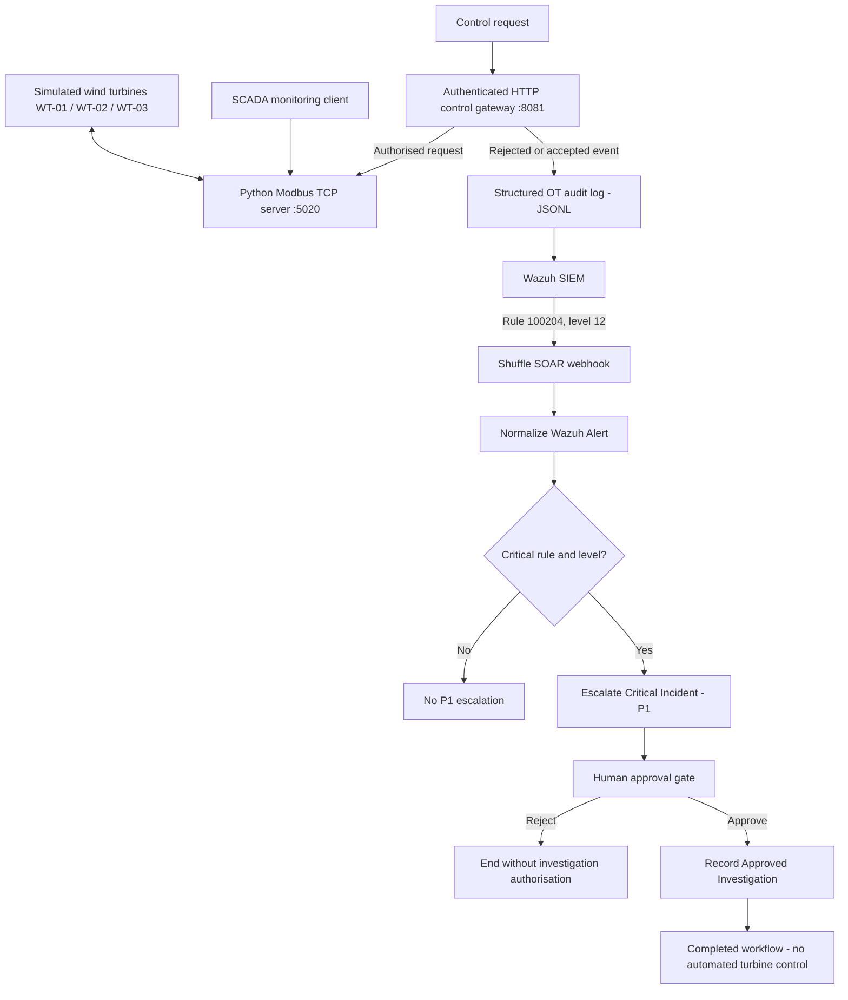

# Wind Farm OT/SCADA Security Monitoring & Incident Response

A security-focused wind farm simulation that combines a Python-based operational technology (OT) environment, authenticated control gateway, structured security audit logging, Wazuh SIEM detection, and Shuffle SOAR human-in-the-loop incident response.

> **Scope:** Independent educational security lab using simulated turbines and control traffic. No production wind turbines or industrial assets are connected.

## What the project demonstrates

- Monitoring three simulated wind turbines (`WT-01`, `WT-02`, `WT-03`) through a Modbus TCP/SCADA environment.
- Applying authenticated controls to simulated turbine power-limit requests through an HTTP gateway.
- Rejecting unauthorised commands and recording structured OT security events in JSONL format.
- Detecting suspicious operations and correlating repeated authentication failures with custom Wazuh rules.
- Automatically forwarding a critical Wazuh alert to Shuffle SOAR.
- Classifying critical incidents, requesting human approval, and recording an approved investigation without issuing automated turbine-control commands.
- Demonstrating both approval and rejection paths, plus noncritical-alert filtering.

## Architecture



## Components

| Layer | Implementation | Purpose |
| --- | --- | --- |
| OT simulation | Python / PyModbus | Three simulated turbines and Modbus TCP telemetry/control interface |
| SCADA | Python client | Reads turbine state and aggregate output |
| Control security | Authenticated HTTP command gateway | Gates simulated control requests; rejects invalid credentials |
| Audit | JSONL event logging | Records control results, actors/source details, and error reasons |
| SIEM | Wazuh 4.14.9 | Ingests logs and detects OT security events |
| SOAR | Self-hosted Shuffle | Webhook-driven incident classification and human approval |
| Deployment | Docker | Hosts Wazuh and Shuffle services |

### Important local ports

| Service | Port |
| --- | --- |
| Simulated Modbus TCP server | `5020` |
| HTTP control gateway | `8081` |
| Shuffle frontend | `3001` |
| Shuffle backend | `5001` |

These are the ports used in this lab; adjust as needed for other deployments.

## Detection and response

The critical scenario involves multiple unauthorised `SET_POWER_LIMIT` requests against the same turbine. The HTTP gateway rejects invalid authentication attempts and generates events such as:

```json
{
  "event_type": "OT_COMMAND",
  "action": "SET_POWER_LIMIT",
  "result": "REJECTED",
  "reason_code": "AUTH_FAILED",
  "source_ip": "127.0.0.1",
  "turbine_id": "WT-02",
  "requested_limit_kw": 1500,
  "environment": "windfarm-lab"
}
```

The sample above is abbreviated and illustrative. Actual events also include fields such as event IDs and timestamps.

Wazuh correlation **rule `100204` (level `12`)** detects repeated authentication failures affecting the same turbine, using a configured threshold of five matching failures within 60 seconds. The Wazuh-to-Shuffle integration forwards alerts for rule `100204` to a Shuffle webhook.

In Shuffle, `WindFarm-OT-Security-Incident` follows this sequence:

1. `Normalize_Wazuh_Alert` — standardise alert metadata.
2. `Escalate_Critical_Incident` — classify rule `100204` at level `12` as a P1 critical OT security incident.
3. `User_Input_1` — pause for a human approve/reject decision; a separate `WindFarm-Approval-Notification` subflow handles approval-notification details.
4. `Record_Approved_Investigation` — only on approval, record permission to review logs and preserve evidence.

A rejection does **not** execute `Record_Approved_Investigation`. Noncritical alerts do **not** proceed through the P1 path.

**Safety boundary:** Shuffle does not issue Modbus writes or HTTP commands to adjust turbine settings. The approval audit records `"automated_turbine_control": false`.

## Verified results

The following results were obtained in the local simulation on **11 November 2026**:

| Test | Evidence | Result |
| --- | --- | --- |
| Human rejection | User Input reported `User declined the input`; approved-only investigation action did not run | **PASS** |
| Noncritical alert | Synthetic rule `100201`, level `5`, normalised but did not trigger P1 escalation | **PASS** |
| Fresh end-to-end incident | New Wazuh rule `100204` alert triggered Shuffle via webhook; administrator approved; investigation authorisation recorded; execution finished | **PASS** |

### Final automatic execution

| Field | Observed value |
| --- | --- |
| Shuffle execution source | `webhook` |
| Start | `2026-11-11 19:37:03` |
| Finish | `2026-11-11 19:38:13` |
| Incident ID | `1794425821.4188` |
| Affected turbine | `WT-02` |
| Wazuh rule | `100204`, level `12` |
| Classification | `CRITICAL_OT_SECURITY_INCIDENT` |
| Priority | `P1` |
| Approval | Approved by `admin` |
| Final audit status | `INVESTIGATION_AUTHORISED` |
| Workflow status | `FINISHED` |

The final audit action authorises security investigation; it does **not** claim that a forensic investigation or external evidence preservation was performed.

## Repository guide

Recommended locations for supporting documentation and evidence:

```text
README.md
src/                         # Python simulation and SCADA source
logs/                        # Local lab logs (do not publish sensitive/raw logs)
docs/
  CP1_*.md
  CP2_*.md
  CP3_*.md
  CP4_Shuffle_SOAR.md
  CP5_Incident_Response_Report.md
  evidence/                  # Curated, redacted screenshots
```

The directory layout above is a guide; use actual file and folder names in the repository. Avoid committing secrets, tokens, `.env` values, raw credentials, or personal information.

## Running the lab

The implementation was validated on a Windows workstation with PowerShell and Docker. The general order is:

1. Start Docker Desktop and the existing Wazuh and Shuffle stacks using the project's own compose configuration and environment values.
2. Start the Python Modbus simulation (`python src/modbus_server.py`) and the associated SCADA/gateway components according to the local project configuration.
3. Check that Wazuh ingests the OT JSONL log and that the existing Shuffle webhook is active.
4. Run a controlled invalid-credential test **against the local simulation only** and inspect the Wazuh/Shuffle execution results.

**Note:** A fully reproducible fresh-machine installation guide, including every dependency, secret, mount path, and gateway entrypoint, requires checking the exact repository files. This README intentionally does not invent those commands.

## Key design decisions

- **Fail closed on invalid credentials:** unauthorised control attempts are rejected at the HTTP gateway.
- **Separate monitoring from control:** Wazuh and Shuffle observe/respond to events without controlling turbine setpoints.
- **Human-in-the-loop approval:** investigation authorisation requires an operator decision.
- **Decision-aware routing:** a click alone is not approval; the decision reason must indicate approval.
- **Structured evidence:** JSONL audit events and Shuffle execution records support review and incident reconstruction.

## Limitations and next steps

- The environment is a simulation, not a production-certified OT/SCADA deployment.
- Shuffle's investigation action records authorisation within the workflow, not an external incident ticket or immutable evidence archive.
- The normalised `operator_approval_required` field is presently hardcoded to `true`; actual critical routing is enforced by rule/level conditions.
- A production deployment would require hardening, secrets management, documented retention, network isolation, and separate validation of safety controls.
- Further platform diagnostics may be warranted for nonblocking Shuffle warnings observed during development.

## Documentation

- [CP4 — Shuffle SOAR Integration](docs/CP4_Shuffle_SOAR.md)
- [CP5 — Incident Response Report](docs/CP5_Incident_Response_Report.md)

