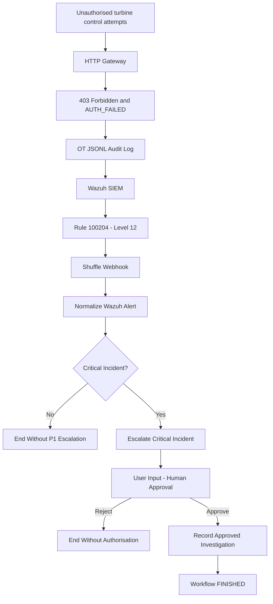

# CP4 — Shuffle SOAR Integration and Incident Response

**Project:** Wind Farm OT/SCADA Security Monitoring & Incident Response  
**Checkpoint:** CP4 — Security Orchestration, Automation and Response (SOAR)  
**Platform:** Self-hosted Shuffle SOAR integrated with Wazuh SIEM 4.14.9  
**Validation Date:** 11 November 2026  
**Status:** COMPLETE — CP4.1 through CP4.6 validated

---

## 1. Objective

Integrate the existing simulated wind farm OT security monitoring system with Shuffle SOAR to detect, classify, escalate, and respond to repeated unauthorised turbine control attempts.

The system uses Wazuh SIEM to detect suspicious activity and Shuffle SOAR to orchestrate a human-in-the-loop security investigation.

The workflow must not automatically change turbine operating parameters or execute control commands.

### Acceptance Criteria

- Deploy Shuffle SOAR locally using Docker.
- Integrate Wazuh SIEM with Shuffle through a webhook.
- Receive and normalise OT security alerts.
- Identify critical authentication-failure incidents.
- Escalate critical incidents to P1 priority.
- Require human approval before authorising an investigation.
- Prevent approved-only actions when an operator rejects a request.
- Exclude noncritical alerts from the P1 escalation path.
- Verify a fresh end-to-end incident from Wazuh to Shuffle.
- Record the investigation authorisation decision.

---

## 2. System Architecture

### 2.1 Existing Wind Farm Environment

The simulated OT environment consists of:

| Component | Description |
|---|---|
| Wind Turbines | WT-01, WT-02, WT-03 |
| Modbus TCP Server | Python/PyModbus simulation, port 5020 |
| SCADA Client | Monitors turbine measurements and simulated power output |
| HTTP Control Gateway | Authenticated turbine control interface, port 8081 |
| OT Audit Logging | Structured JSONL security events |
| Wazuh SIEM | Security monitoring, detection, and event correlation |
| Shuffle SOAR | Alert orchestration and human approval |

The HTTP gateway protects simulated turbine-control operations by rejecting requests that fail authentication.

Rejected attempts produce structured audit records containing fields such as:

- `event_type`
- `action`
- `result`
- `reason_code`
- `source_ip`
- `turbine_id`
- `requested_limit_kw`
- `timestamp`

These records are ingested by Wazuh for security monitoring.

### 2.2 End-to-End Security Workflow



**Security boundary:** Shuffle authorises security investigation and evidence preservation only. It does not perform automated turbine-control operations.

---

## 3. CP4.1 — Shuffle SOAR Deployment

**Status: COMPLETE**

### Objective

Deploy a locally hosted Shuffle SOAR environment capable of receiving Wazuh alerts and executing incident-response workflows.

### Deployment

Shuffle was deployed using Docker.

The following containers were verified running:

| Container | Purpose |
|---|---|
| `shuffle-frontend` | User interface and workflow design |
| `shuffle-backend` | Workflow API and orchestration |
| `shuffle-orborus` | Worker orchestration |
| `shuffle-opensearch` | Workflow and execution data persistence |
| `shuffle-security` | Security-related service |

### Local Interfaces

Shuffle frontend:

```text
http://localhost:3001
```

Shuffle backend:

```text
http://localhost:5001
```

### Verification

Windows PowerShell:

```powershell
docker ps --format "table {{.Names}}\t{{.Status}}" --filter "name=shuffle"
```

All five principal Shuffle services were confirmed running.

**CP4.1 Result: PASS**

---

## 4. CP4.2 — Wazuh SIEM to Shuffle Integration

**Status: COMPLETE**

### Objective

Automatically forward Wazuh correlation alerts to Shuffle for incident orchestration.

### Wazuh Detection Rule

The integration targets:

| Property | Value |
|---|---|
| Rule ID | 100204 |
| Severity Level | 12 |
| Description | Repeated authentication failures against the same turbine |
| Event Type | OT_COMMAND |
| Result | REJECTED |
| Reason Code | AUTH_FAILED |

Rule `100204` correlates repeated authentication failures affecting the same turbine.

The implemented correlation threshold is five matching failures within a 60-second window.

### Wazuh Integration Configuration

The Wazuh manager uses the following integration structure:

```xml
<integration>
  <name>shuffle</name>
  <hook_url>http://host.docker.internal:3001/api/v1/hooks/webhook_REDACTED</hook_url>
  <rule_id>100204</rule_id>
  <alert_format>json</alert_format>
</integration>
```

The actual webhook identifier has been redacted.

### Shuffle Webhook

The main workflow uses a webhook trigger named:

```text
Wazuh_OT_Alerts
```

When Wazuh generates a matching alert, the webhook automatically starts the Shuffle incident-response workflow.

### Initial Verification — 9 November 2026

A simulated attack was generated using six invalid-token requests against turbine `WT-02`.

Observed results:

1. The control gateway rejected the requests with HTTP 403.
2. The OT audit log recorded authentication failures.
3. Wazuh detected the repeated failures.
4. Rule `100204`, level `12`, fired.
5. Shuffle received the alert through the webhook.
6. A new Shuffle workflow execution was created.

Automatic webhook delivery was subsequently revalidated during CP4.6 on 11 November 2026.

**CP4.2 Result: PASS**

---

## 5. CP4.3 — Alert Normalisation

**Status: COMPLETE**

### Objective

Transform the incoming Wazuh webhook payload into a consistent incident record.

### Shuffle Action

```text
Normalize_Wazuh_Alert
```

Application:

```text
Shuffle Tools
```

Function:

```text
repeat_back_to_me
```

### Input

The Wazuh webhook provides fields including:

```text
$exec.id
$exec.timestamp
$exec.rule_id
$exec.text.turbine_id
$exec.text.source_ip
$exec.text.reason_code
$exec.all_fields.rule.level
```

### Verified Normalised Output

The following output was captured during the final end-to-end validation on 11 November 2026:

```json
{
  "incident_id": "1794425821.4188",
  "detected_at": "2026-11-11T19:37:01.491+0000",
  "source_system": "Wazuh SIEM",
  "environment": "windfarm-lab",
  "rule_id": "100204",
  "rule_level": "12",
  "rule_description": "Wind farm: Repeated authentication failures against the same turbine",
  "turbine_id": "WT-02",
  "source_ip": "127.0.0.1",
  "event_id": "07b77b0d-d332-4266-9edc-cf9a7da76eb3",
  "event_type": "OT_COMMAND",
  "action": "SET_POWER_LIMIT",
  "result": "REJECTED",
  "reason_code": "AUTH_FAILED",
  "requested_limit_kw": "1500",
  "status": "NEW",
  "operator_approval_required": true,
  "automated_turbine_control": false
}
```

### Implementation Note

Fields were referenced directly from the original `$exec` payload.

Earlier attempts to reference individual properties of the `repeat_back_to_me` output caused string-substitution issues. Referencing the original webhook fields resolved those problems.

### Known Refinement

The `operator_approval_required` value is currently hardcoded as `true` in the normalisation template.

The routing conditions correctly prevent noncritical escalation, but this field should eventually be derived from the incident classification.

**CP4.3 Result: PASS**

---

## 6. CP4.4 — Critical Incident Classification and Escalation

**Status: COMPLETE**

### Objective

Identify serious OT security events and escalate them for security operator review.

### Shuffle Action

```text
Escalate_Critical_Incident
```

Function:

```text
repeat_back_to_me
```

### Escalation Conditions

The connection between normalisation and escalation uses two conditions:

```text
$exec.rule_id = 100204
```

AND

```text
$exec.all_fields.rule.level = 12
```

Only matching alerts proceed along the P1 escalation path.

### Verified Output

```json
{
  "incident_id": "1794425821.4188",
  "turbine_id": "WT-02",
  "source_ip": "127.0.0.1",
  "rule_id": "100204",
  "rule_level": "12",
  "classification": "CRITICAL_OT_SECURITY_INCIDENT",
  "priority": "P1",
  "escalation": "SECURITY_OPERATOR_REVIEW",
  "status": "PENDING_HUMAN_APPROVAL",
  "recommended_response": "Investigate authentication failures and preserve evidence",
  "automated_turbine_control": false
}
```

### Response Policy

Critical alerts are classified and escalated to a human operator.

No automated turbine shutdown, power-limit adjustment, or Modbus control operation is initiated.

**CP4.4 Result: PASS**

---

## 7. CP4.5 — Human Approval and Investigation Authorisation

**Status: COMPLETE**

### Objective

Require an explicit human decision before recording an investigation as authorised.

### Workflow Structure

```text
Normalize_Wazuh_Alert
        |
        v
Escalate_Critical_Incident
        |
        v
User_Input_1
        |
        v
Record_Approved_Investigation
```

The final action runs only when approval conditions are satisfied.

### User Input Configuration

Trigger:

```text
User Input
```

Node:

```text
User_Input_1
```

Approval options:

```text
boolean
```

The parent workflow pauses until an operator approves or rejects the request.

### Approval Notification Subflow

A separate workflow was created:

```text
WindFarm-Approval-Notification
```

Workflow ID:

```text
cbf04550-254f-4df0-92e2-34bae05f1943
```

Its action is:

```text
Display_Approval_Request
```

The notification workflow receives the approval request details and callback information.

### Approval Decision

The following approval was recorded:

```json
{
  "success": true,
  "source": "userinput",
  "reason": "User approved the input",
  "click_info": {
    "clicked": true,
    "user": "admin"
  }
}
```

### Approval-Only Conditions

The transition to `Record_Approved_Investigation` checks:

```text
$user_input_1.click_info.clicked = true
```

AND

```text
$user_input_1.reason = User approved the input
```

Checking `clicked` alone is insufficient because a rejected request also records that the operator clicked a response.

### Investigation Authorisation

Action:

```text
Record_Approved_Investigation
```

Implementation:

```text
Shuffle Tools → repeat_back_to_me
```

Verified output:

```json
{
  "incident_id": "1794425821.4188",
  "decision": "APPROVED",
  "status": "INVESTIGATION_AUTHORISED",
  "action": "Security analyst may review logs and preserve evidence",
  "automated_turbine_control": false
}
```

The result records authorisation within Shuffle's execution history.

It does not claim that a separate investigation was carried out or that evidence was transferred to an external archive.

### Implementation Issues Resolved

#### Issue 1 — Incorrect Subflow Reference

The User Input node initially referenced the main security workflow as its own subflow.

This caused an additional execution of the main workflow containing approval information instead of a Wazuh alert.

**Resolution:** Created and selected the separate `WindFarm-Approval-Notification` workflow.

#### Issue 2 — Workflow Stuck in EXECUTING

The Shuffle worker repeatedly reported:

```text
Status: EXECUTING, Results: 3, actions: 4
Inside Decide execution with 3 / 4 results
```

The workflow connections were inspected and corrected.

The intended action sequence was restored:

```text
Normalize
    ↓
Escalate
    ↓
User Input
    ↓
Record Approved Investigation
```

A subsequent approval execution completed successfully.

#### Issue 3 — Platform Warnings

Diagnostic logs included:

- Approval timestamp unmarshalling warning.
- Authentication-token lookup warning.
- A recurring Tenzir network warning involving `shuffle_swarm_executions`.

These warnings were not established as the causes of the original execution problem.

The final corrected workflow subsequently reached `FINISHED`.

### Successful Approval Execution

| Field | Result |
|---|---|
| Started | 11 November 2026, 18:07:37 |
| Finished | 11 November 2026, 18:18:55 |
| Execution Status | FINISHED |
| Decision | APPROVED |
| Approving Operator | admin |
| Investigation Record | INVESTIGATION_AUTHORISED |
| Automated Turbine Control | false |

**CP4.5 Result: PASS**

---

## 8. CP4.6 — Final Validation

**Status: COMPLETE**

Three validation tests were performed to verify normal approval, rejection handling, noncritical filtering, and fresh automatic webhook execution.

### 8.1 Test 1 — Human Rejection

**Test Date:** 11 November 2026

| Property | Value |
|---|---|
| Started | 18:35:19 |
| Finished | 18:36:15 |
| Input | Saved critical rule 100204 alert |
| Final Status | FINISHED |
| Result | PASS |

The alert passed normalisation and P1 escalation.

The operator rejected the investigation request.

#### Observed Decision

```json
{
  "success": false,
  "source": "userinput",
  "reason": "User declined the input",
  "click_info": {
    "clicked": true,
    "user": "admin"
  }
}
```

#### Expected Behaviour

- Normalise the security alert.
- Escalate the critical incident.
- Request administrator approval.
- Record rejection.
- Do not execute the approval-only investigation action.

#### Observed Behaviour

`Record_Approved_Investigation` was absent from the execution results.

The workflow reached `FINISHED` without recording `INVESTIGATION_AUTHORISED`.

**Test 1 Result: PASS**

---

### 8.2 Test 2 — Noncritical Alert Filtering

**Test Date:** 11 November 2026

| Property | Value |
|---|---|
| Started | 19:00:59 |
| Finished | 19:01:46 |
| Incident ID | CP46-NONCRITICAL-001 |
| Rule ID | 100201 |
| Rule Level | 5 |
| Final Status | FINISHED |
| Result | PASS |

A synthetic noncritical Wazuh-format payload was submitted to Shuffle manually.

#### Input Characteristics

```json
{
  "severity": 2,
  "pretext": "WAZUH Alert",
  "title": "Wind farm: Single authentication failure",
  "rule_id": "100201",
  "id": "CP46-NONCRITICAL-001",
  "all_fields": {
    "rule": {
      "id": "100201",
      "level": 5,
      "description": "Noncritical authentication failure"
    }
  }
}
```

#### Observed Results

The normalisation action completed successfully and identified:

```json
{
  "incident_id": "CP46-NONCRITICAL-001",
  "rule_id": "100201",
  "rule_level": "5",
  "turbine_id": "WT-02",
  "result": "REJECTED",
  "reason_code": "AUTH_FAILED"
}
```

No execution results appeared for:

```text
Escalate_Critical_Incident
User_Input_1
Record_Approved_Investigation
```

The workflow correctly excluded the alert from the critical escalation path.

**Scope:** This was a synthetic routing test, not an automatic Wazuh webhook test for rule 100201.

**Test 2 Result: PASS**

---

### 8.3 Test 3 — Fresh Wazuh-to-Shuffle End-to-End Validation

**Test Date:** 11 November 2026

This was the final integration test of CP4.

Unlike the earlier saved-input tests, this execution was automatically triggered through the Wazuh webhook.

#### Execution Details

| Property | Value |
|---|---|
| Started | 19:37:03 |
| Finished | 19:38:13 |
| Source | webhook |
| Execution Status | FINISHED |
| Incident ID | 1794425821.4188 |
| Wazuh Timestamp | 2026-11-11T19:37:01.491+0000 |
| Rule ID | 100204 |
| Rule Level | 12 |
| Turbine | WT-02 |
| Source IP | 127.0.0.1 |
| Priority | P1 |
| Operator | admin |
| Result | PASS |

#### Step 1 — Simulated Security Incident

Multiple invalid-token attempts were issued against the local turbine-control gateway.

The attempts targeted:

```text
Turbine: WT-02
Action: SET_POWER_LIMIT
Requested Power Limit: 1500 kW
```

The resulting OT security activity was detected by Wazuh.

#### Step 2 — Wazuh Detection

Wazuh produced a fresh rule 100204 alert.

```text
Rule ID: 100204
Rule Level: 12
Description: Wind farm: Repeated authentication failures against the same turbine
```

#### Step 3 — Automatic Shuffle Execution

Shuffle recorded:

```text
Source: webhook
Started: 11/11/2026 19:37:03
Status: FINISHED
```

This confirmed automatic Wazuh-to-Shuffle alert delivery.

#### Step 4 — Alert Normalisation

The incoming incident was normalised into a structured record identifying:

```text
Incident ID: 1794425821.4188
Turbine: WT-02
Result: REJECTED
Reason: AUTH_FAILED
Rule: 100204
Level: 12
```

#### Step 5 — Critical Escalation

Shuffle classified the incident:

```text
Classification: CRITICAL_OT_SECURITY_INCIDENT
Priority: P1
Escalation: SECURITY_OPERATOR_REVIEW
Status: PENDING_HUMAN_APPROVAL
```

#### Step 6 — Human Approval

The operator approved the investigation.

```text
Reason: User approved the input
Clicked: true
User: admin
```

#### Step 7 — Investigation Authorisation

The final action produced:

```json
{
  "incident_id": "1794425821.4188",
  "decision": "APPROVED",
  "status": "INVESTIGATION_AUTHORISED",
  "action": "Security analyst may review logs and preserve evidence",
  "automated_turbine_control": false
}
```

#### Step 8 — Workflow Completion

The main execution reached:

```text
Status: FINISHED
Finished: 11/11/2026 19:38:13
```

All expected stages were present.

**Test 3 Result: PASS**

---

## 9. CP4.6 Validation Summary

| Test | Objective | Result |
|---|---|---|
| Test 1 | Rejected approval prevents investigation authorisation | PASS |
| Test 2 | Noncritical alert bypasses P1 escalation | PASS |
| Test 3 | Fresh Wazuh incident automatically triggers Shuffle | PASS |
| Test 3 | Critical incident is classified as P1 | PASS |
| Test 3 | Administrator approval is recorded | PASS |
| Test 3 | Investigation authorisation is recorded | PASS |
| Test 3 | Main workflow reaches FINISHED | PASS |

**CP4.6 Result: PASS — All three tests completed successfully.**

---

## 10. OT Security and Safety

The project uses a human-in-the-loop incident-response design.

### Security Controls

1. Authentication is required for turbine-control requests.
2. Invalid requests are rejected by the gateway.
3. Security events are recorded in structured audit logs.
4. Wazuh correlates repeated authentication failures.
5. Shuffle escalates critical alerts.
6. Human approval is required for investigation authorisation.
7. Rejected approval requests cannot execute approved-only actions.
8. The Shuffle workflow does not include turbine-control actions.

### Important Boundary

```json
{
  "automated_turbine_control": false
}
```

This field represents the intended security boundary of the SOAR workflow.

The workflow does not contain an action that changes turbine power limits.

Independent confirmation that no OT command occurred during a validation window would require reviewing the relevant gateway and Modbus audit logs.

---

## 11. Evidence Collection

The following evidence is recommended for inclusion in the project repository.

| Evidence File | Description |
|---|---|
| `cp4-01-shuffle-containers.png` | Docker containers running |
| `cp4-02-wazuh-alert.png` | Wazuh rule 100204 alert |
| `cp4-03-workflow-canvas.png` | Complete Shuffle workflow |
| `cp4-04-approval.png` | Successful human approval |
| `cp4-05-rejection.png` | Rejected investigation request |
| `cp4-06-noncritical.png` | Noncritical alert filtering |
| `cp4-07-webhook-e2e.png` | Final automatic webhook execution |
| `cp4-08-investigation-record.png` | Approved investigation output |

These filenames are suggestions; they do not imply the screenshots have already been saved.

### Evidence Security

Do not publish:

- Webhook secrets
- Approval authorization tokens
- Shuffle API credentials
- Authentication headers
- Sensitive callback URLs

Redact secrets from logs and screenshots before publishing the project.

---

## 12. Troubleshooting and Lessons Learned

### 12.1 Incorrect Subflow Selection

**Problem:** User Input referenced the parent workflow itself.

**Impact:** Approval information entered a second execution of the main security workflow.

**Resolution:** Created a separate approval-notification workflow and selected it as the User Input subflow.

### 12.2 Incorrect Workflow Connections

**Problem:** An intermediate execution remained in `EXECUTING`, with the worker expecting four results but recognising only three.

**Resolution:** Corrected the workflow connections and ensured the investigation action followed the human approval gate.

### 12.3 Approval Versus Rejection

**Problem:** Both approval and rejection record:

```text
clicked: true
```

**Resolution:** The approved-only transition also checks the decision reason.

### 12.4 Shuffle Worker and Platform Warnings

During troubleshooting, logs showed:

- Execution rerun messages.
- An approval timestamp unmarshalling warning.
- Subflow authentication-token lookup warnings.
- Tenzir network setup errors.

The final workflow nevertheless completed successfully.

These warnings may be reviewed separately during future platform hardening.

### 12.5 Structured Data Handling

Direct references to `$exec` fields proved reliable for this implementation.

Improving the handling of structured data between Shuffle Tools actions would make the workflow easier to extend.

### 12.6 Audit Persistence

The current implementation records decisions in Shuffle execution results.

For a production-style deployment, investigation records could additionally be sent to:

- A ticketing platform
- A case-management system
- A dedicated incident database
- A tamper-resistant evidence repository

These integrations were not implemented in CP4.

---

## 13. Future Improvements

Potential enhancements include:

1. Improve the operator approval message with concise incident details.
2. Derive `operator_approval_required` from classification logic.
3. Implement external incident-ticket creation.
4. Store evidence metadata in a dedicated incident database.
5. Add operator notification channels.
6. Strengthen execution audit retention.
7. Review recurring Shuffle platform warnings.
8. Introduce incident-response metrics and dashboards.
9. Add evidence-integrity verification.
10. Expand incident-response playbooks for additional OT security scenarios.

These improvements are outside the completed CP4 scope.

---

## 14. CP4 Completion Summary

CP4 successfully integrated Wazuh SIEM and Shuffle SOAR into the simulated wind farm OT security environment.

The completed implementation demonstrates:

- Automatic security alert ingestion
- Repeated authentication-failure detection
- Structured incident normalisation
- Rule-based critical incident escalation
- P1 security incident classification
- Human approval and rejection
- Approval-only investigation authorisation
- Noncritical alert filtering
- Successful end-to-end webhook execution
- Separation between security investigation and turbine control

### Final Verified Incident

```text
Date: 11 November 2026

Incident ID: 1794425821.4188

Detection:
Wazuh Rule 100204
Severity Level 12

Affected Turbine:
WT-02

Classification:
CRITICAL_OT_SECURITY_INCIDENT

Priority:
P1

Human Decision:
APPROVED

Authorisation:
INVESTIGATION_AUTHORISED

Automated Turbine Control:
false

Shuffle Execution:
FINISHED
```

### Final Status

**CP4.1 — COMPLETE**  
**CP4.2 — COMPLETE**  
**CP4.3 — COMPLETE**  
**CP4.4 — COMPLETE**  
**CP4.5 — COMPLETE**  
**CP4.6 — COMPLETE**

**CP4 Overall Result: COMPLETE — 11 November 2026**

---
